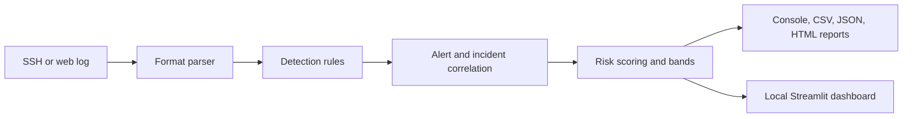

# Sentinel Log Analyser

Sentinel Log Analyser is a local, offline defensive tool for reviewing OpenSSH authentication logs and Nginx/Apache combined access logs. It parses records, applies explainable threshold-based detections, correlates overlapping SSH alerts into incidents, calculates per-source risk scores, and writes console, CSV, JSON, or self-contained HTML reports; a Streamlit dashboard presents the same analysis pipeline interactively. It is intended for authorized log review and uses documentation-range addresses in its synthetic examples.

## Screenshots

Screenshots are not included in this checkout. Capture the running application's
Overview, Alerts, and source-investigation pages before publication; do not use
the brand artwork in assets/ as an application screenshot.

## Features

- Parse supported OpenSSH authentication records and Nginx/Apache combined access logs.
- Attach supported SSH session-open context to a success-after-failures alert only when host, `sshd` PID, and username match within its existing lookback; session context is not an authentication attempt or proof of privilege escalation.
- Detect configured SSH brute force, opt-in low-and-slow brute force, multi-account guessing, invalid-user probing, root targeting, successful login after failures, distributed brute force, off-hours logins, and logins outside a supplied trusted-IP allowlist.
- Detect repeated unauthorized requests to configured web login paths, high volumes of 404 responses, and configured scanner/tool strings in User-Agent values.
- Apply IP/CIDR allowlists, aggregate alerts, correlate overlapping SSH alerts, and calculate explainable per-source risk scores and bands.
- Export CSV and JSON, generate self-contained HTML reports, or download a Markdown report from the dashboard.
- Follow appended log lines in read-only mode and print newly observed alerts once per stable alert key.
- Generate synthetic SSH and web samples using documentation IP ranges.
- Parse OpenSSH `message repeated N times` authentication lines as weighted occurrences without expanding them into duplicate event objects.
- Review a dedicated Successful Logins page, with estimated elapsed time only when a unique host/PID/username lifecycle match exists; supported records do not include a session ID.
- Navigate the dashboard's Overview, Alerts, Incidents, Sources, Timeline, Detection Coverage, Data Quality, Reports, and Settings pages; filter by source IP and parsed-time date range, rule severity, detection rule, targeted username, and alert text.

## Detection rules

Default values come from `config.yaml` and `config.py`; thresholds and time windows can be tuned for a specific environment.

| Rule | What it detects | Default threshold/window | Severity | MITRE ATT&CK ID | Technique |
|---|---|---|---|---|---|
| `ssh_brute_force` | Same-source failure waves, qualified by an inclusive trailing window | 5 failures / 60 seconds; High at 50, sustained at 200 | Medium, High from 50 | T1110.001 | Password Guessing |
| `ssh_low_and_slow_bruteforce` | Sustained SSH failures that stay below the short-window brute-force threshold | Opt-in; 20 weighted failures / 24 hours, with no 5-attempt / 60-second burst | Medium | T1110.001 | Password Guessing |
| `ssh_password_spraying` | One source records failed attempts against multiple distinct usernames | 5 usernames / 60 seconds | Medium | Unmapped | Multi-account guessing; logs do not prove a shared password |
| `ssh_username_enumeration` | Repeated failed attempts against distinct invalid usernames | 4 invalid usernames / 60 seconds | Medium | Unmapped | Invalid-user probing; account discovery is not confirmed |
| `ssh_root_login_attempt` | Failed SSH attempts targeting root; adjacent windows merge | 3 failures / 60 seconds; High at 50, sustained at 200 | Low, High from 50 | T1110 | Brute Force |
| `ssh_success_after_failures` | Successful SSH login after enough recent failures from the same IP | 5 failures / 300 seconds | High | T1078 | Valid Accounts |
| `ssh_distributed_bruteforce` | Multiple source IPs failing against one username | 5 IPs / 120 seconds | High | T1110 | Brute Force |
| `ssh_off_hours_login` | Successful SSH login outside configured business hours; raised when recent failures exist | Outside 08:00–19:00; recent-failure lookback 300 seconds | Low; Medium with recent failures | T1078 | Valid Accounts |
| `ssh_new_source_ip_login` | Successful login from an IP outside a supplied allowlist | One success from an unlisted IP; only enabled when an allowlist is supplied | Low | T1078 | Valid Accounts |
| `web_login_bruteforce` | Repeated 401/403 responses on configured login paths | 5 responses / 60 seconds; default paths `/login`, `/wp-login.php`, `/admin` | Medium | Unmapped | Responses do not prove authentication attempts |
| `web_scanning` | Repeated 404 responses from one source | 10 responses / 60 seconds | Medium | T1595 | Active Scanning |
| `web_suspicious_user_agent` | A configured scanner/tool name in a request User-Agent | Any matching request; grouped in 60-second windows | Low | T1595 | Active Scanning |
| `web_success_after_failures` | 2xx response from a configured login path after repeated 401/403 responses from the same IP | 5 failures / 60 seconds on `/login`, `/wp-login.php`, or `/admin` | High; Critical risk band | Unmapped | A 2xx response does not confirm authentication |

## Architecture



SSH and web detections use one alert-merging, incident-correlation, and risk-scoring pipeline. Alerts for the same rule and source merge when windows overlap or are within the configured merge gap; overlapping rules from the same IP can form one incident.

## Dashboard

The dashboard has Overview, Alerts, Incidents, Sources, Timeline, Detection Coverage, Data Quality, Reports, Settings, and Detailed Analysis pages. Rule-severity alert counts remain separate from unique source-risk bands. Shared source and parsed-time date-range filters scope parsed events; severity, rule, username, and text filters scope alerts/incidents and their downloads. The Timeline page uses an interval brush to scope its event table, labels SSH session records without source attribution as unlinked context, and caps displayed rows while retaining the full in-memory analysis. Source and incident pages show related alerts, events, outcomes, recommendations, and defensible session-open context. Data Quality shows parser counters and bounded malformed-line samples; Detection Coverage displays the maintained rule inventory and limitations. Downloads include filtered JSON, alert CSV, successful-login CSV, HTML, and Markdown. A successful login after failures is labeled a potential compromise indicator, not a confirmed compromise. Timestamps with explicit offsets normalize to UTC. Yearless SSH syslog timestamps use the selected year and remain timezone-unspecified; no host timezone is inferred. The project Streamlit config binds to `127.0.0.1`, disables usage statistics, and uses the minimal toolbar.

## Quick start

### Windows PowerShell

```powershell
python -m venv .venv
.\.venv\Scripts\Activate.ps1
python -m pip install -e ".[dev]"
python -m pytest -v
sshlog-analyzer --file sample_logs/auth.log --year 2026
sshlog-analyzer --file sample_logs/web_access.log --log-type web
streamlit run dashboard.py --server.address 127.0.0.1
```

Use a Python 3.11 or newer installation available as `python`; the Windows `py` launcher is not required.

### Linux or macOS

```sh
python3.13 -m venv .venv
source .venv/bin/activate
python -m pip install -e '.[dev]'
python -m pytest -v
sshlog-analyzer --file sample_logs/auth.log --year 2026
sshlog-analyzer --file sample_logs/web_access.log --log-type web
streamlit run dashboard.py --server.address 127.0.0.1
```

The dashboard binds to loopback in these commands. The application makes no external log-upload or telemetry calls; the CLI and report generator operate locally. If you deliberately host the dashboard remotely, uploaded files are processed by that host, so the loopback privacy behavior does not apply to remote deployments.

### Example output

```text
Log events analyzed            : 37
Security alerts generated      : 7
Parser coverage                : 37 events parsed, 0 lines ignored, 0 malformed
Alerts suppressed by allowlist : 0

High        : 1
Medium      : 5
Low         : 1

198.51.100.60         75/100 Critical
```

The exact timestamps and counts depend on the sample version, configuration, and CLI filters.

## Analyze an authorized real log

Copy an OpenSSH `auth.log` from a machine you own or are authorized to review into a local working directory. For a Loghub OpenSSH sample, use a copy you have obtained and stored locally; this application does not download it. Run:

```powershell
sshlog-analyzer --file .\private-data\auth.log --year 2025 --format html
```

```sh
sshlog-analyzer --file ./private-data/auth.log --year 2025 --format html
```

`--year` supplies the year for yearless syslog timestamps. The parser increments the inferred year when it sees a December-to-January rollover. OpenSSH `message repeated N times: [...]` authentication records are represented as one parsed record with an `occurrence_count`; detections and source-risk volume use that count without expanding duplicate events. `Failed none` remains in the broad all-method failure total but has its own probe count and is excluded from password-oriented detections. Brute-force alerts group same-source activity waves while adjacent failures are at most the configured window apart, and require the threshold inside an inclusive trailing window. Parser counters continue to count input lines and parsed records. Review parser coverage because distro versions, PAM messages, and log formats vary.

Use `--show-malformed` to print grouped parser-reason counts and up to 50 malformed line numbers. It does not print raw log text. The dashboard provides a malformed-record expander with reason counts and at most 100 line-number samples. Reason labels are conservative classifications for supported log formats; they do not diagnose every unsupported distribution format.

To compare authentication counts independently on a local OpenSSH file, run `python tools/verify_counts.py PATH --year YEAR`. It uses raw-record regular expressions, reports password failures separately from `Failed none`, tracks repeat weights and source-specific waves, and compares the raw counts with Sentinel's parsed output. In a validation of a separately supplied 2,000-line `OpenSSH_2k.log`, the independent result was 518 literal password-failure records plus 10 represented repeats (528 logical failures), 4 `Failed none` probes, and 378 root password failures; Sentinel matched those totals. The dataset is not bundled, and this check does not establish accuracy on other OpenSSH versions or environments.

For combined Nginx/Apache access logs:

```sh
sshlog-analyzer --file ./private-data/access.log --log-type web --format all
```

### Testing on real logs

Obtain `OpenSSH_2k.log` yourself from the [Loghub 2.0 OpenSSH 2k dataset](https://github.com/logpai/loghub-2.0/blob/main/2k_dataset/OpenSSH/OpenSSH_2k.log),
review its [dataset license](https://github.com/logpai/loghub-2.0/blob/main/LICENSE), and place your local copy at
`sample_logs/OpenSSH_2k.log`; this project does not download the file. That dataset is reported to use yearless syslog timestamps from 2016; this checkout does not include the file, so verify the year against your local copy before analysis:

```powershell
sshlog-analyzer --file .\sample_logs\OpenSSH_2k.log --year 2016 --format all
```

The filename is ignored by Git so a real third-party log does not become project
content. Review your local `git status` if that filename was tracked previously.
Loghub 2.0's terms limit availability to research or academic work and require
reference to its repository, with citation of the listed papers where applicable;
include its notice in any copy and verify your intended use and any redistribution
meet those terms. This project does not include or redistribute the dataset.

For a read-only tail of appended SSH lines, use `--follow`. It starts at the current end of an existing file (or waits for a missing file), handles truncation/rotation, retains a bounded event window, and prints each alert once plus meaningful updates after five additional attempts; press Ctrl+C to stop.

## Risk score

The current transparent score is calculated per source IP:

```text
score = min(10 × distinct alert rules, 40)
      + min(20, int(20 × log1p(failed events) / log1p(1000)))
      + 15 if a failed root attempt exists
      + 30 if SSH/web success-after-failures is confirmed
```

The result is clamped to 0–100. Confirmed success-after-failures guarantees at least 75 (Critical); all other activity is capped at 74. Failure-volume scoring uses all terminal authentication failures, including `Failed none` probes as activity evidence; password-oriented detections exclude those probes, and the parser reports them separately. Ties in risk score sort by total event count, then most recent event, then IP. Bands are:

| Score | Band |
|---:|---|
| 0–24 | Low |
| 25–49 | Medium |
| 50–74 | High |
| 75–100 | Critical |

Correlated incident severity follows the source IP's risk band; for example, a 75–100 score yields a Critical incident. Individual alerts retain their rule severity as `severity` and `base_severity`; their `source_risk_score` and `source_risk_band` describe composite per-IP context, not an override of rule severity.

The score is a triage aid. It is not proof that an event is malicious.

## Configuration and allowlists

`config.yaml` defines thresholds, detection windows, root-attempt minimums, severity escalation points, the adjacent-alert merge gap, business hours, web login paths, and suspicious User-Agent patterns. The low-and-slow SSH detector is opt-in (`low_and_slow.enabled: false` by default), with a default threshold of 20 weighted failures in 24 hours that must stay below the configured short-window brute-force threshold. A null `alert_merging.merge_gap_seconds` uses each rule's detection window; a non-negative integer overrides the gap. The CLI accepts `--config PATH`; explicit CLI threshold flags override file values, which override built-in defaults. `--brute-threshold` and `--window` override SSH brute-force settings.

An allowlist is an optional text file with one IP address or CIDR per line; blank lines and `#` comments are ignored. The new-source login rule is disabled when no allowlist is supplied. Supplying an empty allowlist enables the rule while trusting no external addresses; a populated allowlist marks its matching IPs/CIDRs as known. Example using a documentation-only range:

```text
# Trusted lab range example; replace only with networks you are authorized to manage.
192.0.2.0/24
```

Pass it with `--allowlist trusted_ips.txt`. Allowlisted sources suppress supported source-based alerts. The dashboard has an equivalent optional text box. By default, `new_source_ip.trusted_local_sources` treats `127.0.0.1/32` and `::1/128` as trusted only for the new-source login rule; other detections remain active for loopback traffic. This list accepts IP/CIDR entries and can be changed in `config.yaml`.

## Exit codes

| Code | Meaning |
|---:|---|
| 0 | No alerts found |
| 1 | Alerts found, with no High alert or incident |
| 2 | A High- or Critical-severity alert or incident is present |
| 3 | Input, configuration, or other expected analysis error |

These codes are intended for shell scripts and CI jobs. A live `--follow` session returns 0 when it is stopped cleanly.

## Limitations

- Shared NAT IPs can make unrelated users look like one source and inflate risk scores.
- Low-and-slow attacks may stay below fixed count thresholds or fall across separate windows.
- OpenSSH formats and surrounding PAM messages vary across Linux distributions and versions.
- Tests use synthetic data, so their patterns may not represent every real environment.
- Thresholds and business hours need tuning for the organization and log volume.
- A risk score is a triage aid, not proof of compromise or intent.
- The score does not directly weight account privilege or time of day; NAT egress can inflate its event volume.

## Ethics and safe use

Use this project for defensive log analysis only. Analyze only logs you own or are authorized to review. The included synthetic examples use reserved documentation IP ranges (`192.0.2.0/24`, `198.51.100.0/24`, and `203.0.113.0/24`). Do not publish real logs or secrets in issues, screenshots, or sample fixtures.

## Roadmap

- ML-based anomaly scoring connected to the KAP Sentinel project.
- SIEM export formats such as CEF and ECS.
- Optional local GeoIP database support.
- Additional defensive log sources and parsers.

## Beta status

Sentinel is early-beta software. The current package and CLI version is 0.4.0.
Detection results require analyst interpretation; Sentinel must not be the sole
basis for high-impact security decisions. Automated synthetic regressions and
one separately supplied 2,000-line OpenSSH sample have been reviewed, but that
does not establish general real-world accuracy.

## Development

Install the pinned development extras with `python -m pip install -e '.[dev]'`. Run tests with `python -m pytest -v`, lint and formatting checks with `ruff check .` and `ruff format --check .`, and the 100,000-line synthetic benchmark with `python benchmark.py`. GitHub Actions runs lint, formatting, and tests on Python 3.11, 3.12, and 3.13.

See [DEVELOPMENT.md](DEVELOPMENT.md) for setup and checks, [CONTRIBUTING.md](CONTRIBUTING.md) for a detection-rule walkthrough, [docs/OUTPUTS.md](docs/OUTPUTS.md) for report fields, [docs/ARCHITECTURE.md](docs/ARCHITECTURE.md) for data flow, [docs/THREAT_MODEL.md](docs/THREAT_MODEL.md) for trust boundaries, [docs/evaluation.md](docs/evaluation.md) for synthetic evaluation limits, [docs/performance.md](docs/performance.md) for a reproducible synthetic benchmark measurement, [docs/BRANDING.md](docs/BRANDING.md) for concept assets, and [SECURITY.md](SECURITY.md) for safe vulnerability reporting.

## License

The project source is distributed under the MIT License; see [LICENSE](LICENSE).
Third-party datasets and dependencies have their own terms and are not relicensed
by this project's MIT license.
