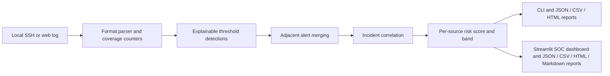

# Architecture

`ssh_parser.py` and `web_parser.py` normalize supported input formats. Rule
logic lives in `detections.py` and `web_detections.py`; both feed the common
analysis, merge, correlation, and risk-scoring path in `detections.py`. The CLI
and dashboard call these same modules. Exporters receive analysis results and
do not rerun detection logic.

Alert `base_severity` describes one rule. Source risk score/band summarizes
activity from an IP. A correlated incident's `combined_severity` follows the
source risk band when present. These fields are intentionally distinct.
