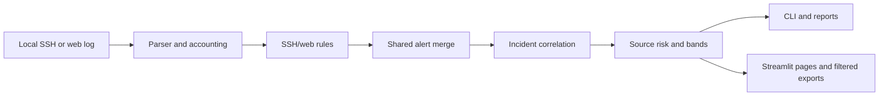

# Sentinel Product Audit and Implementation Plan

> Historical audit and roadmap: dated validation counts and checklist states below describe their recorded milestones, not the current release state. See [the final validation report](FINAL_VALIDATION_REPORT.md) for the later maintainer-provided v0.4.0 results; those results were not rerun in this audit.

**Repository:** `C:\dev\ssh-log-analyzer`
**Observed branch:** `feat/repeated-lines-and-dashboard-v2`
**Observed HEAD:** `424f7f8` (`Weighted repeated-message parsing, dashboard v2, parser coverage`)
**Audit run:** 2026-10-19, Python 3.13.15, Windows
**Scope:** Evidence-based status at this audit; pre-existing working-tree edits are user-owned and were not reset, staged, or committed.

Status values are `COMPLETE`, `PARTIAL`, `MISSING`, `BLOCKED`, and `NEEDS APPROVAL`. `COMPLETE` means the stated acceptance target has direct implementation and test evidence; it does not imply real-world accuracy or release certification.

## A. Current architecture

The application is a local Python package with a CLI in `analyzer.py`, SSH parsing in `ssh_parser.py`, combined access-log parsing in `web_parser.py`, SSH/web rules in `detections.py` and `web_detections.py`, common alert merging, incident correlation and source-risk calculation in `detections.py`, a Streamlit application in `dashboard.py`, and CSV/JSON/HTML/Markdown exporters. Configuration is YAML plus validated CLI/dashboard overrides. Streamlit is pinned and configured to bind to `127.0.0.1`; usage statistics are disabled. No service/API or browser-side log upload is part of the design.

Architecture decision: **retain and incrementally improve Streamlit**. Existing shared analysis/filter functions and Streamlit native navigation already support the needed local workflows; switching stacks would add migration and dependency risk without evidence that the current application cannot meet acceptance criteria.

## B. Existing functionality

Verified in source/tests: local SSH and Nginx/Apache combined access-log parsing; normalized timestamps and year rollover; malformed/ignored-line accounting; weighted repeated-message events; configurable detection rules and CIDR allowlists; opt-in low-and-slow detection; severity, source-risk and incident schemas; session-open context with constrained linkage; CLI, follow mode, JSON/CSV/HTML/Markdown reporting; local dashboard; deterministic synthetic evaluation; 100k-line benchmark; pinned dependencies; Ruff, pytest and multi-version CI configuration.

## C. Incomplete functionality

The UI gaps addressed in this milestone are light-theme tokens, integrated local SVG branding, first-class Timeline/Data Quality/Detection Coverage pages, selected-source investigation, incident contributing-alert details, shared source/date and alert filters, and filtered exports. Browser verification confirmed an interactive timeline brush reduced the sample event table from 37 to 15 rows, and the explicit clear-selection button restored all 37 rows. Desktop and narrow viewports were visually inspected. Remaining dashboard verification gaps include an exhaustive keyboard-only accessibility pass and exhaustive combinations of browser filter interactions; the legacy Detailed Analysis page remains as a compatibility view. Engine/policy gaps: sudo/su records are not retained or linked; session-close records remain unlinked; confidence is not calibrated; expiring false-positive suppressions do not exist. The optional real-log tests are skipped because the Loghub sample is absent.

## D. UI/UX audit

The current app uses Streamlit native sidebar navigation and nine SOC pages plus Detailed Analysis. The bundled synthetic SSH sample was inspected in the in-app browser at narrow (391px) and desktop (1440px) viewports: the light theme is readable, the title wraps cleanly, and source/timeline pages render sample evidence. The Sources page showed selected-source risk, weighted outcomes, related alerts/incidents, user and method summaries, and activity. Timeline brushing reduced the visible events from 37 to 15 and its clear button restored all 37. Dashboard AppTests cover Overview and the focused pages, including empty/helper behavior. The local SVG wordmark and icon are integrated. A keyboard-only accessibility pass and exhaustive browser filter/export workflow review remain outstanding. During server restarts and direct deep-link navigation, browser logs included transient health-check connection/404 errors; a stable in-app navigation click to Timeline produced no new browser console errors. This is not a claim that every browser warning has been eliminated.

Implemented tokens in `.streamlit/config.toml` and `docs/BRANDING.md`: light neutral background/surfaces, restrained teal primary, slate text, system sans-serif, and Streamlit semantic severity colors. Native columns/widgets/tables provide spacing and responsive behavior without a CSS framework. A sidebar theme section now explicitly applies the same tokens. Focus appearance relies on Streamlit defaults and still needs a keyboard/manual accessibility pass. No screenshot artifact is committed; current screenshot placeholders in README are intentionally left for the maintainer to replace.

## E. Graph and visualization audit

| Graph | Current implementation and source | Current interaction | Gap / planned improvement | Test strategy |
|---|---|---|---|---|
| Overview failed attempts by hour | `dashboard._attempts_by_hour(events)` and `st.line_chart`; weighted SSH failures and web 401/403/404 responses | Static Streamlit chart; scoped by active source/date event filters | Existing meaningful summary, labeled failed attempts; no interval selection | Helper, parser accounting, AppTest |
| Timeline failed events by hour | `_timeline_chart` (Altair), computed from active source/date events | Interval brush filters chronological table; clear button removes selection; UTC labels | Browser verified 37 -> 15 events on brush and 15 -> 37 on clear using the synthetic sample | Altair serialization, epoch-boundary parsing, inclusive filter tests, and browser interaction |
| Detailed Analysis hourly failures and per-source lines | Matplotlib/Agg plots from selected events, weighted outcomes | Static, scoped by source/date and optional alert/incident focus | Compatibility detail view; labels use UTC hour and failed attempts | Dashboard AppTest plus shared helpers |
| Top risky sources | Overview dataframe and Sources risk table, both from shared risk scores | Sources page selectbox opens source investigation | Selected-source details are browser-rendered and AppTest-covered | Source outcome and integration tests |
| Targeted usernames / root outcomes | Sources page dataframe from parsed authentication events | Static table and summary | Actual parser counts only; no inference for unsupported events | Root/user summary tests and AppTest |
| HTML report timeline and top-risk plot | Embedded base64 Matplotlib PNGs from the same events/risk result | Static in standalone report | No external chart resources; empty report handled | HTML report/schema/security tests |

Severity, rule-count, source-risk, incident-severity, and malformed-trend charts are not currently implemented; dashboard cards and tables present those measures without implying a chart exists. No redundant charts were added merely to increase chart count.

Altair is declared directly and pinned at 5.5.0 for the timeline interval-selection API; it is the existing Streamlit chart engine, not an additional visualization stack. The selection has a defined table-filter action and an explicit reset button.

## F. Investigation workflow audit

Alerts share global severity/rule/username/search filters and expose a selected alert's evidence and recommendation. Incidents show composite severity and source risk separately, attempt/evidence totals, contributing alerts, session evidence, and a source/time-bounded timeline. Sources provide selectable IP investigation with outcomes, alerts/incidents, rules, usernames, methods, timestamps and activity. Timeline displays parsed activity chronologically, marks no-source session records as unlinked, and uses a brush to scope its event table. Shared source/date filters apply to event views; alert-specific filters apply to alerts/incidents/downloads; the sidebar states that scope. Browser inspection confirmed selected-source investigation and the timeline brush/clear workflow. Keyboard-only workflows and exhaustive browser filter combinations remain unverified.

## G. Engine and detection audit

Direct evidence: SSH rules are listed in `docs/detection-inventory.md` and implemented in `detections.py`; web rules are implemented in `web_detections.py` and fed through the same `analyze_events` path. Risk band limits and calculation are documented in the `calculate_risk_scores` docstring and tested. Low-and-slow is configured `enabled: false`. Repeated weights and line/event accounting are covered by `tests/test_repeated_syslog.py` and `tests/test_parser_accounting.py`. Parser variants and boundaries have unit tests. No detection threshold, risk formula, rule ID, MITRE mapping, allowlist semantics, or repeated-message semantics is approved for modification in this plan.

| ID | Status | Evidence / already implemented | Incomplete / dependency / risk | Acceptance criteria | Milestone / validation |
|---|---|---|---|---|---|
| ENG-01 Parser and count integrity | COMPLETE | `ssh_parser.py`, `web_parser.py`, `event_accounting.py`; parser-accounting and repeat tests | Real distro-specific logs unavailable | Physical-line partition and weighted event/outcome semantics stay documented and tested | M1; parser/integration tests |
| ENG-02 Detection and risk semantics | COMPLETE | `detections.py`, `web_detections.py`, inventory; threshold/risk/evaluation tests | Synthetic cases do not establish production accuracy | Existing formula, IDs, thresholds and rule evidence remain unchanged absent verified defect | M1; suite and golden scenarios |
| ENG-03 Incident/session evidence | PARTIAL | Incident correlation and session-open linkage tests; last task preserves context | Session-close unlinked; sudo/su not parsed; no shared TTY/session identity | Keep linked evidence deduplicated and separate from attempts; unsupported linkage never inferred | M1; incident/output tests |
| ENG-04 Confidence/false-positive controls | NEEDS APPROVAL | Explicit allowlist, rule evidence and synthetic evaluation exist | No calibrated confidence or expiring, audited suppression policy; representative labeled corpus required for calibration | Do not add probability or suppression until calibration/policy is approved | M1; policy decision and labeled evaluation |
| ENG-05 Real-log validation | BLOCKED | Optional tests in `test_real_log.py` and `test_ssh_parser.py` are present | Optional Loghub file absent and its license terms restrict use | Run only on user-provided, locally held, authorized sample; document version and scope | M1/M4; optional integration tests |

## H. Report consistency audit

The CLI and dashboard both call the common analyzer; `filter_dashboard_data` produces filtered events, alerts, risk scores, incidents, and exports. JSON includes alerts/incidents/risks/parse stats; CSV is intentionally alert-row based; HTML is standalone with inline CSS and base64 PNG; Markdown is a dashboard export. Existing tests cover CSV formula safety, HTML escaping, output schemas, empty reports, and filtered dashboard downloads. Improve shared dashboard filter behavior and test cross-view counts without changing public report contracts; any new incident context field must remain documented and safe.

## I. Security and privacy audit

Evidence: local parser and analysis path, loopback Streamlit configuration, disabled usage statistics, no requests/upload/enrichment call in source, temporary upload data under ignored `reports/`, HTML escaping, Markdown cell escaping, CSV formula-prefix protection, config validation, and explicit safe-use documentation. Dashboard uses Streamlit text/table primitives for log text; only static headings use `st.markdown` with escaped identifiers. Pinned dependencies and a security policy exist. No dependency advisory database lookup was run because that would require network access; `pip check` verifies dependency consistency, not vulnerabilities. Continue using synthetic documentation IPs and do not transmit logs.

## J. Performance and scalability audit

`benchmark.py` measures synthetic parsing/detection and list-vs-deque window pruning; `docs/performance.md` records a machine-specific historical comparison. `test_alert_merge_scaling.py` protects the alert-merge complexity improvement. Parsers are streaming over file lines but retain event objects for analysis; UI dataframes and charts are in-memory. No peak-memory measurement or current full 100k benchmark was taken during this audit. Measure before optimization; preserve evidence and avoid arbitrary performance assertions.

## K. Automated testing audit

Observed baseline: `python -m pytest -v` **131 passed, 2 skipped**; both skips require optional Loghub data. Ruff lint passed, Ruff format check passed (33 files already formatted), `pip check` passed, and `git diff --check` passed. `tests/test_dashboard.py` uses Streamlit `AppTest` for startup and helpers; Playwright and Selenium are not installed. Browser surface inspection is available through the Codex in-app browser. Coverage is configured in the dev environment but no fresh coverage report was generated in this audit. CI in `.github/workflows/tests.yml` covers Python 3.11–3.13.

## L. Documentation and GitHub presentation audit

README includes installation, sample use, rules, architecture, limitations, ethics, configuration and roadmap. Architecture, output schema, detection inventory, counting, threat-model, evaluation and performance docs exist. Branding is documented as concept SVG assets. CI and a bug-report issue template exist. `docs/baseline.md` is historical and correctly labels its earlier baseline. The new product audit is the authoritative completion checklist. Keep README claims tied to actual behavior; add screenshots only after safe synthetic rendering and inspection.

## M. Architecture decisions and risks

| Decision | Status | Choice / risk |
|---|---|---|
| Dashboard framework | COMPLETE | Keep Streamlit; no evidence warrants a React/API migration. |
| Interactive visualization | COMPLETE | Altair timeline interval selection filters the chronological events and a clear button resets it; browser verified the 37 -> 15 -> 37 sample row sequence and UTC axis labels. |
| sudo/su attribution | NEEDS APPROVAL | Either display parsed records only as unlinked host-level context, or require an explicit shared TTY/session key. Username/time proximity alone is not defensible. |
| Confidence measure | NEEDS APPROVAL | No probability until representative labeled data and calibration method exist; explain evidence and limitations instead. |
| Expiring suppression | NEEDS APPROVAL | Define rule/source scope, expiry, persistence, audit format and review flow before implementing. Existing allowlist stays unchanged. |
| External dependency audit | BLOCKED | A full advisory scan requires external vulnerability data; keep the app offline and report this limit. |

## N. Milestone-based implementation plan

| Milestone | Scope | Status |
|---|---|---|
| M1 — Engine reliability and investigation | Audit parsers, counts, detections, correlation, evidence, false-positive evaluation and measured performance; implement only verified compatible fixes | PARTIAL; core engine baseline is tested, UI investigation and real data remain |
| M2 — Complete SOC dashboard | Light design system, integrated branding, usable navigation, shared filters, timeline/data-quality/coverage, source/incident drill-down, useful charts, accessibility and browser validation | PARTIAL; desktop/narrow layouts and timeline interaction verified; keyboard accessibility and exhaustive browser workflows remain |
| M3 — Integration, security and reporting | Ensure filtered scopes/output fields agree; validate local-only paths, config, escaping, empty/error cases, performance and reports | PARTIAL; shared helpers, output/security tests, and key browser flows verified; exhaustive integration remains |
| M4 — Documentation and release readiness | Keep README/docs/audit/report aligned, safe demo, screenshots if possible, final checks and clean-environment validation | PARTIAL; docs and final checks updated; screenshots remain placeholders and clean-environment install not repeated |

Execution order: complete M1 only for evidenced defects, then prioritize M2 UX and investigation improvements, then M3 integration/security review, then M4 documentation and final validation. A semantic or architectural decision that requires approval is kept as a blocked sub-item; independent work continues.

## O. Acceptance criteria

- No pre-existing staged, unstaged, or untracked user work is overwritten or discarded; no stage/commit/push/release occurs.
- Dashboard is light, coherent and readable at desktop and narrow viewports; existing SVG branding is used without remote assets.
- Navigation pages are functional, have useful empty states, and do not imply unsupported analysis.
- Active source/date/severity/rule/username filters have one documented scope and are reflected consistently in metrics, charts, tables, source/incident investigation and downloads.
- Timeline and source/incident detail use actual parsed evidence and label unlinked context honestly; timeline brush and clear behavior verified in the local browser.
- Detection coverage describes real rule IDs, thresholds, severity, evidence, tests and real-data status from implementation/docs.
- Existing CLI/report contracts and protected detection semantics remain unchanged; log-derived strings remain safe in reports.
- Focused and full tests, Ruff, format, pip check and diff checks pass; browser checks are reported separately from AppTest.
- Real-world accuracy and security audit claims remain limited to evidence actually available.

## P. Final release-readiness checklist

- [x] Audit rows updated with implementation evidence/status; final command results will be recorded after validation.
- [ ] All dashboard pages and all listed graphs inspected in a browser; desktop and narrow layouts checked, but exhaustive page-by-page and keyboard validation remains.
- [x] Shared filter helpers, empty results, drill-down, and filtered-export helpers covered by tests; timeline brush and clear interaction verified in browser.
- [x] Browser console signals reviewed: transient errors during restarts/deep links; no new errors on stable in-app Timeline navigation. Browser network-failure inspection was unavailable.
- [x] Existing test suite and CI checks pass; two optional Loghub tests remain skipped because the sample is absent.
- [x] Dependency pins and `pip check` reviewed; an external advisory scan was not run to keep this audit offline.
- [x] Reports, escaping, and filter scope remain covered by tests.
- [ ] Performance claims measured on stated input/machine; no unsupported guarantee.
- [ ] README, architecture, config, outputs, detection inventory, audit and final validation report agree.
- [ ] No secrets/private logs; synthetic addresses remain documentation ranges.
- [ ] Git changes remain unstaged and uncommitted for user review.

## Q. Dashboard audit implementation and final validation (2026-10-19)

This pass added effective-occurrence accounting to Data Quality, clarified filter scopes, removed Markdown link targets from the coverage inventory to prevent dead/local navigation, and repaired timeline brush parsing for Streamlit's epoch-millisecond selection values. The chart serializes UTC timestamps and labels the axis in UTC. A dedicated clear-selection button replaces reliance on double-click clearing, which did not work reliably in the browser gesture used during verification.

Focused dashboard tests: **30 passed**. Full repository validation: `python -m pytest -v` **146 passed, 2 skipped**; Ruff lint passed; Ruff format check passed; `pip check` passed; `git diff --check` passed. Both skips depend on the unavailable optional Loghub sample. The local synthetic SSH sample browser check demonstrated 37 events, 15 within a brushed interval, then 37 after clear. No real-log accuracy or remote-browser-network claim is made.

The local Streamlit browser pass covered Overview, Alerts, Incidents, Sources, Timeline, Detection Coverage, Data Quality, and Reports; Detailed Analysis remains covered by AppTest rather than a live-browser pass. The browser tooling exposed console logs but not request-level network failure inspection. The full dashboard backlog therefore remains PARTIAL where explicitly marked above.

## R. SOC dashboard redesign follow-up (2026-10-19)

Implemented a consistent light-theme SOC treatment across the Overview and native Streamlit pages. The main Overview header uses the existing `sentinel-icon.svg` beside the Sentinel Log Analyser name, local-first summary, and local-processing indicator; compact page headers reuse the icon. Native navigation retains all ten destinations and uses page icons. Overview metrics now use semantic severity accents, followed by input context, a weighted failed-activity chart, a source-risk chart with score/band tooltip, and outcome summaries. Alerts and source pages keep their investigation tables and details; Data Quality and Detailed Analysis use less crowded metric groupings. No new UI dependency or remote asset was added during this follow-up.

Browser checks at approximately 391px verified the Overview and Alerts render without horizontal clipping in the inspected viewport, semantic cards stack, the SVG brand is visible, and the alert table/detail view remains accessible. The collapsed-sidebar control initially overlapped the logo; a phone-width top inset now prevents that overlap. Desktop/intermediate widths were not rechecked during this follow-up. Other pages were inspected during the preceding local browser pass and remain covered by AppTest; exports were not downloaded in this browser pass.

Switching from SSH to the web sample exposed a filter-state bug: old SSH rule/username selections persisted when the option lists changed and hid web alerts. A regression test was added first and reproduced an empty rule filter; the data-dependent filter now resets when its options change. AppTest and live browser verification show all three web sample alerts (2 Medium, 1 Low) after switching.

The latest full validation before the final mobile inset assertion was `python -m pytest -v` **163 passed, 2 skipped**; final results are recorded in `docs/FINAL_VALIDATION_REPORT.md`. The two skips require the absent optional Loghub corpus. Earlier Ruff and dependency checks passed; final rerun is required for the report. Streamlit emitted empty sidebar-theme-color warnings during an earlier running session; after removing unsupported sidebar theme settings, a stable browser console check showed no warning/error entries. Request-level browser network inspection is not exposed by the available tool, so this is not claimed as a full network audit. No claim is made about untested viewport widths or downloaded export behavior.
